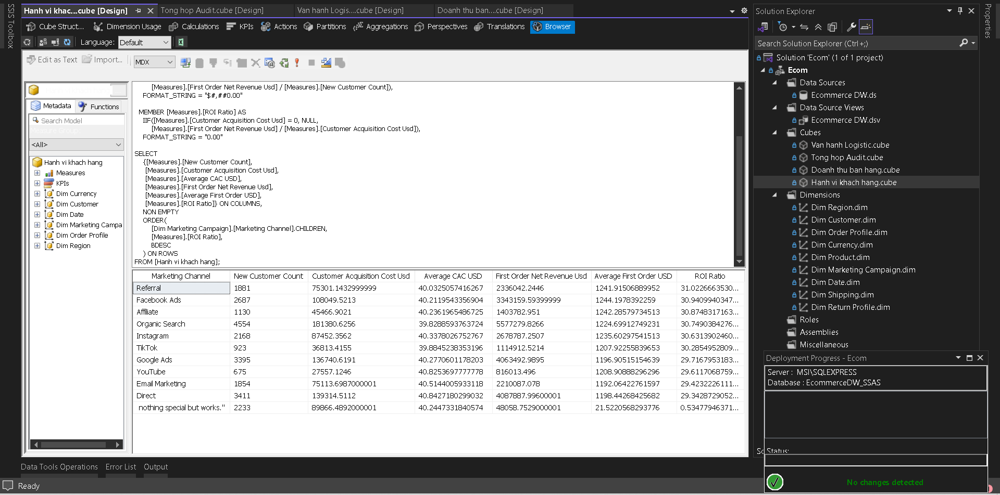
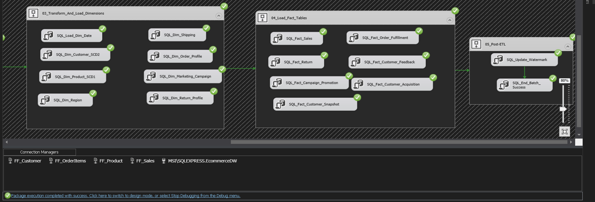
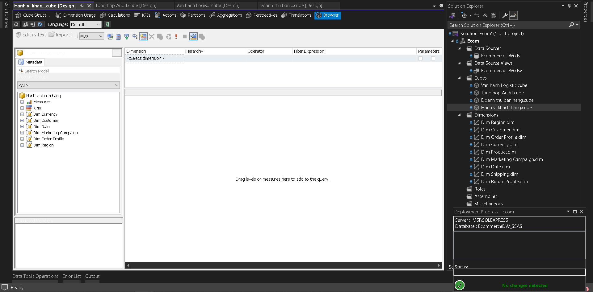
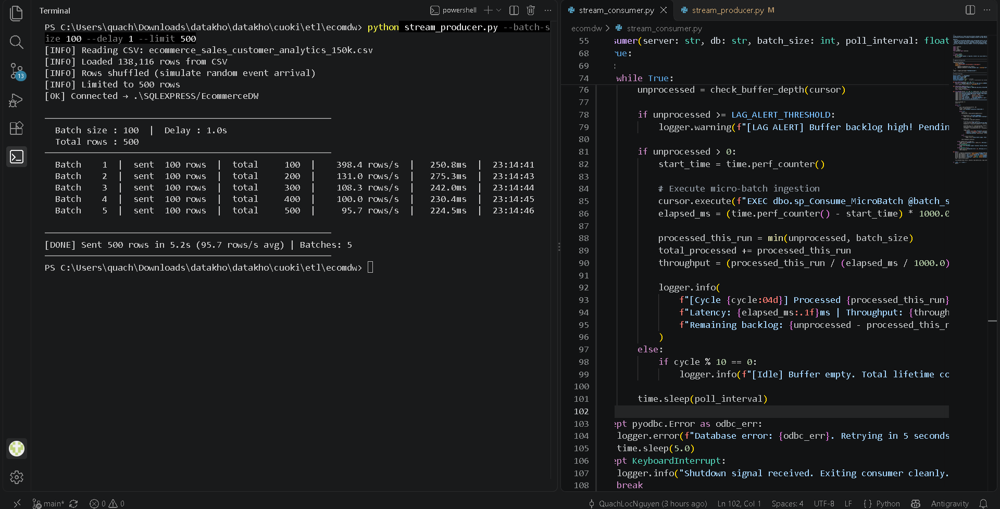

# Ecommerce Data Warehouse & Analytics Platform

> **End-to-end Data Engineering capstone project** — Galaxy-Schema DWH on SQL Server with SSIS ETL pipeline, SSAS OLAP Cubes, and a Near Real-Time Micro-Batch streaming layer simulating continuous order ingestion.


---

## Architecture

```
┌──────────────────────────────────────────────────────────────────┐
│  SOURCE                 STAGING              DWH                 │
│  4 CSV files      →     4 stg_* tables  →   9 Dimensions         │
│  138K orders            (SQL Server)         7 Fact Tables       │
│  397K line-items                             EcommerceDW         │
│  25K customers                                                   │
│  1.1K products                                   ↓               │
│                                             SSAS OLAP            │
│                                             4 Subject Cubes      │
├──────────────────────────────────────────────────────────────────┤
│  STREAMING LAYER (Near Real-Time)                                │
│  stream_producer.py → stg_sales_stream → sp_Consume_MicroBatch   │
│  (Python pyodbc)       (watermark buffer)   (SQL Agent, 30s)     │
└──────────────────────────────────────────────────────────────────┘
```

---

## Business Questions Answered

This Data Warehouse is built to answer **3 core business questions** driving strategic operational decisions:

---

### ❓ BQ1 — Does discounting destroy profit margins?
> *"Which product categories are most vulnerable to margin erosion from discounts — and where can promotional budgets be safely expanded?"*

**Queries:** `03_Queries_SQL.sql` (BQ1) · `04_Queries_MDX.mdx` (BQ1)


#### 📊 Business Insights & Decisions:
1. **Most Severe Margin Bleed — Electronics:**
   - **Current Reality:** Accounts for the platform's largest revenue share (**$39.3M**) and absorbs massive promotional discounts (**$7.59M**), yet delivers the **lowest contribution margin rate across the entire catalog (only 34.46%)**.
   - **Actionable Decision:** Immediately tighten deep-discount (>20%) campaigns for Electronics, as steep price reductions directly cannibalize gross margins without driving proportionate profit.
2. **High-Margin Anchors — Books & Media, Grocery, Toys & Games:**
   - Consistently sustain outstanding margin rates **> 51% – 52%** even under standard discount schedules.
   - **Actionable Decision:** Reallocate promotional budgets and cross-sell bundle packages toward these categories to accelerate revenue growth while protecting bottom-line profitability.

---

### ❓ BQ2 — Which customers are worth keeping? (Customer Health & Churn Risk)
> *"What is the churn risk and Customer Lifetime Value (CLV) distribution across Customer Segments at the latest monthly snapshot?"*

**Queries:** `03_Queries_SQL.sql` (BQ2) · `04_Queries_MDX.mdx` (BQ2)


#### 📊 Business Insights & Decisions:
1. **Customer Base Health & Retention:**
   - Exceptionally healthy customer foundation: **Average RFM Score stands at a perfect 5.0**, with rapid repurchase velocity (**Average Recency is ~14.5 days**, far below the 90-day churn alert threshold) $\rightarrow$ **0% Churn Risk**.
2. **Customer Lifetime Value (CLV):**
   - The **Consumer** segment commands the highest customer lifetime value (**$4,249.50/customer**), followed closely by **Corporate ($4,215.29)** and **Home Office ($4,192.90)**.
   - **Actionable Decision:** Direct premium loyalty rewards and VIP retention incentives toward the Consumer segment to maximize LTV, while structuring bulk-order discount tiers for Corporate accounts.

---

### ❓ BQ3 — Which marketing channel has the best ROI?
> *"Comparing Customer Acquisition Cost (CAC) vs First-Order Net Revenue by channel — which channels deliver sustainable returns, and which are bleeding budget?"*

**Queries:** `03_Queries_SQL.sql` (BQ3) · `04_Queries_MDX.mdx` (BQ3)



#### 📊 Business Insights & Decisions:
1. **High-Yield Acquisition Channels (~31x Return):**
   - **Referral (31.02x)**, **Facebook Ads (30.94x)**, **Affiliate (30.87x)**, and **Organic Search (30.74x)** are the most capital-efficient acquisition drivers.
   - Blended Customer Acquisition Cost (**Avg CAC**) is tightly controlled at **~$40.00**, while first-order net revenue reaches **~$1,240+**.
2. **Budget Waste Identified — `nothing special but works` Campaign:**
   - **Current Reality:** Acquisition spend remains high at **$40.24/customer** (~$90K total outlay), yet customers acquired through this campaign spend an average of only **$21.52** on their initial purchase!
   - **Impact:** **ROI Ratio collapses to 0.53x** (recovering only $0.53 for every $1 spent $\rightarrow$ **a -47% net loss on first purchases**).
   - **Actionable Decision:** Immediately terminate ad spend for this campaign and reallocate capital into proven high-return channels such as **Referral** and **Facebook Ads**.

---

## Data Scale

| Fact Table | Rows | Description |
|---|---|---|
| `Fact_Sales` | **397,482** | Core transaction grain: 1 line-item per order |
| `Fact_Order_Fulfillment` | 113,559 | Accumulating snapshot: delivery tracking |
| `Fact_Customer_Snapshot` | 131,716 | Periodic snapshot: monthly RFM + loyalty tier |
| `Fact_Customer_Feedback` | 113,559 | Customer review & sentiment per order |
| `Fact_Customer_Acquisition` | 24,911 | First-event fact: CAC per new customer |
| `Fact_Campaign_Promotion` | 14,986 | Coupon & promotion transaction fact |
| `Fact_Return` | 9,462 | Return transaction fact |
| **Total Net Revenue (USD)** | **~\$192M** | Multi-currency normalized to USD |

---

## Key Features

### 1. Galaxy Schema — 9 Dimensions + 7 Facts

| Category | Tables |
|---|---|
| **Core Facts** | Fact_Sales, Fact_Order_Fulfillment, Fact_Return |
| **Strategic Facts** | Fact_Customer_Feedback, Fact_Customer_Acquisition, Fact_Customer_Snapshot, Fact_Campaign_Promotion |
| **Dimensions** | Dim_Date (role-playing), Dim_Customer **(SCD Type 2)**, Dim_Product (SCD Type 1), Dim_Region, Dim_Shipping, Dim_Order_Profile **(Junk)**, Dim_Marketing_Campaign, Dim_Return_Profile, Dim_Currency |

### 2. SSIS ETL Pipeline — 5-Container Design

Architected an automated 5-container SSIS package with parallel CSV ingestion, SCD Type 2 customer upsert, 6-category error quarantine, and watermark-based incremental loading — processing ~800K rows in a single batch run.

| Container | Tasks | Pattern |
|---|---|---|
| **C00 — Prepare** | Truncate staging → Begin batch → Seed unknown keys + 7 FX rates | Sequential |
| **C01 — Extract** | 4× Flat File → OLE DB Fast Load | **Parallel** |
| **C02 — Quarantine** | Classify errors into `etl_reject` (NULL/TYPE/BUSINESS/ORPHAN/DUP/RANGE) | Sequential |
| **C03 — Load Dims** | 7× Dim SP (SCD2 Customer, SCD1 Product, SCD0 others) | **Parallel** |
| **C04 — Load Facts** | 7× Fact SP with TRY…CATCH error isolation | **Parallel** |
| **C05 — Close** | Update watermark → Close batch SUCCESS | Sequential |




### 3. Multi-Currency Support

- **7 currencies supported:** USD, EUR, GBP, CAD, AUD, INR, AED.
- All monetary facts store **dual columns**: original currency amount + normalized `_usd` via `Dim_Currency.exchange_rate_to_usd`.
- Enables unified multinational financial consolidation across SSAS cubes without data duplication.

### 4. SSAS — 4 Subject-Area OLAP Cubes

Decomposed a monolithic cube into 4 subject-area multidimensional cubes for targeted business analytics:

| Cube Name | Subject Area | Measure Groups | Sample Calculated Measures |
|---|---|---|---|
| **Doanh thu ban hang** | Sales & Revenue Analytics | Fact_Sales, Fact_Return, Fact_Campaign | `Margin Rate %`, `Discount Rate %`, `Return Revenue Rate %`, `Coupon Usage Rate %` |
| **Van hanh Logistic** | Logistics & Fulfillment | Fact_Order_Fulfillment | `Late Delivery Rate %`, `Avg Delivery Delay (days)` |
| **Hanh vi khach hang** | Customer Behavior & Lifetime Value | Fact_Feedback, Fact_Acquisition, Fact_Snapshot | `Average CAC USD`, `Negative Review Rate %`, `Points Redemption Rate %` |
| **Tong hop Audit** | Enterprise Data Reconciliation | All 7 facts | Base Fact Counts — cross-fact data verification |



### 5. Near Real-Time Streaming Layer

Implemented a micro-batch streaming architecture simulating real-time order event ingestion:

```
stream_producer.py          stg_sales_stream          sp_Consume_MicroBatch
─────────────────           ────────────────          ─────────────────────
• Reads 138K CSV rows       • BIGINT stream_id        • Watermark: stream_id
• Shuffles for realism      • DATETIME2(3) ingest_time  > last processed
• Inserts in configurable   • is_processed BIT        • Batches & inserts
  batches (default: 100)    • Partial index on          into Fact_Sales
• Real-time throughput logs   unprocessed rows        • Idempotent: NOT EXISTS
                                                      • SQL Agent Job: every 30s
```



---

## Project Structure

```
ecomdw/
├── 00_Create_Staging_Tables.sql    # Staging DDL — 4 stg_* buffer tables
├── 01_Create_EcommerceDW_v2.sql    # DWH DDL — 9 Dims + 7 Facts + ETL metadata
├── 04_Streaming_Setup.sql          # Streaming DDL — buffer table + SP + watermark
├── 03_Queries_SQL.sql              # Core business questions (BQ1-BQ3) + 15 Rubric SQL queries
├── 04_Queries_MDX.mdx              # OLAP queries (BQ1-BQ3) + 9 Rubric MDX queries
├── stream_producer.py              # Python micro-batch event producer
├── stream_consumer.py              # Python consumer & monitoring utility
├── du_lieu_csv/                    # Source dataset (4 CSV files)
│   ├── ecommerce_sales_customer_analytics_150k.csv   # 138K orders
│   ├── order_items.csv                               # 397K line-items
│   ├── product_catalog.csv                           # 1.1K products
│   └── customer_master.csv                           # 25K customers
├── SSIS_ETL_Project/               # Visual Studio SSIS Solution (.dtsx)
└── SSAS_OLAP_Project/              # Visual Studio SSAS Solution
    └── Ecom/                       # 4 OLAP Cubes (.cube) + 9 Dimensions (.dim)
```

---

## Setup & Run

### Prerequisites
- SQL Server 2019 + SSMS 18+
- Visual Studio 2019/2022 with **SSIS** and **SSAS** extensions installed
- Python 3.8+ with `pyodbc`

### Execution Steps

```powershell
# 1. Initialize DWH Schema (Execute in SSMS in sequential order)
#    00_Create_Staging_Tables.sql
#    01_Create_EcommerceDW_v2.sql
#    04_Streaming_Setup.sql

# 2. Run SSIS ETL Pipeline
#    Open SSIS_ETL_Project in Visual Studio → Press F5 (Run Package)

# 3. Deploy SSAS OLAP Cubes
#    Open SSAS_OLAP_Project in Visual Studio → Build → Deploy → Process Full

# 4. Run Streaming Simulation
pip install pyodbc
python stream_producer.py --batch-size 100 --delay 0.5

# Consume micro-batches in SSMS:
# EXEC dbo.sp_Consume_MicroBatch @batch_size = 5000;
# SELECT * FROM dbo.vw_Stream_Dashboard;
```

---

## Sample Queries

### SQL — Top Countries by Net Revenue

```sql
SELECT
    r.country,
    SUM(fs.net_revenue_usd)             AS net_revenue_usd,
    ROUND(SUM(fs.contribution_margin_usd) * 100.0
          / NULLIF(SUM(fs.net_revenue_usd), 0), 2) AS margin_rate_pct
FROM dbo.Fact_Sales fs
JOIN dbo.Dim_Region r ON fs.region_key = r.region_key
GROUP BY r.country
ORDER BY net_revenue_usd DESC;
```

### MDX — Margin Rate % by Country (SSAS)

```mdx
SELECT
  {[Measures].[Net Revenue Usd], [Measures].[Margin Rate %]} ON COLUMNS,
  [Dim Region].[Country].[Country].MEMBERS ON ROWS
FROM [Doanh thu ban hang];
```

---

## Skills Demonstrated

| Competency | Core Skills |
|---|---|
| **Data Modeling** | Kimball Galaxy Schema, SCD Type 1 & 2, Junk Dimension, Role-Playing Dimension, Degenerate Dimension |
| **ETL Engineering** | SSIS parallel containers, 6-category error quarantine, watermark incremental load, idempotent design |
| **OLAP & BI** | SSAS Multidimensional, MDX calculated members, subject-area cube decomposition |
| **Streaming & Operations** | Micro-batch pattern, watermark timestamping, Python producer → T-SQL consumer pipeline |
| **Database & SQL** | T-SQL window functions, SCD2 MERGE upsert, TRY…CATCH isolation, multi-currency conversion |
| **Python** | pyodbc, csv.DictReader, argparse CLI, real-time throughput metrics |

---

## Dataset

Source: [Kaggle — E-Commerce Sales & Customer Analytics](https://www.kaggle.com/datasets/datascikhan/e-commerce-sales-and-customer-analytics)

> 138,117 orders · 397,482 line-items · 25,000 customers · 1,175 products · 2021–2025 · 7 countries · 7 currencies
