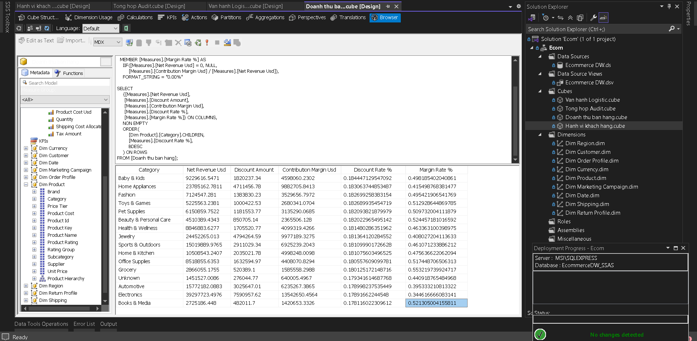
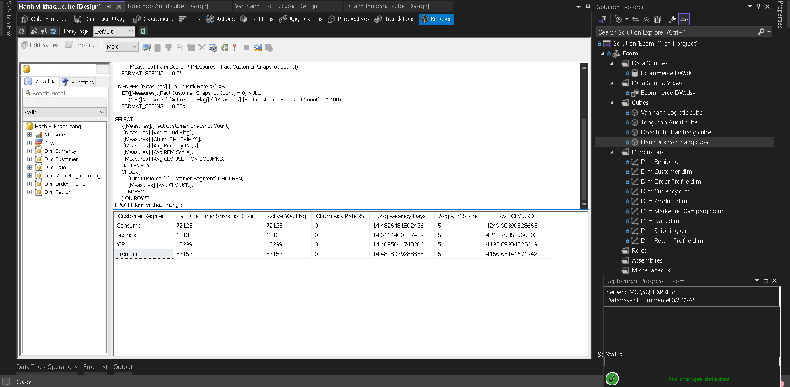
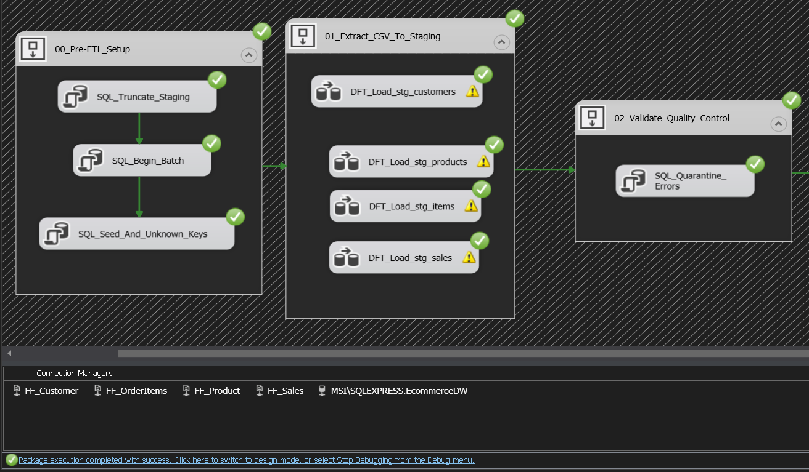

# Ecommerce Data Warehouse & Analytics Platform

> **End-to-end Data Engineering capstone project** — Galaxy-Schema DWH on SQL Server with SSIS ETL pipeline, SSAS OLAP Cubes, and a Near Real-Time Micro-Batch streaming layer simulating continuous order ingestion.


---

## Architecture

```
┌──────────────────────────────────────────────────────────────────┐
│  SOURCE                 STAGING              DWH                  │
│  4 CSV files      →     4 stg_* tables  →   9 Dimensions         │
│  138K orders            (SQL Server)         7 Fact Tables        │
│  397K line-items                             EcommerceDW          │
│  25K customers                                                     │
│  1.1K products                                   ↓                │
│                                             SSAS OLAP             │
│                                             4 Subject Cubes       │
├──────────────────────────────────────────────────────────────────┤
│  STREAMING LAYER (Near Real-Time)                                  │
│  stream_producer.py → stg_sales_stream → sp_Consume_MicroBatch   │
│  (Python pyodbc)       (watermark buffer)   (SQL Agent, 30s)      │
└──────────────────────────────────────────────────────────────────┘
```

---

## Business Questions Answered

This DWH is designed to answer **3 core business questions** that drive real operational decisions:

---

### ❓ BQ1 — Does discounting destroy profit margins?
> *"Which product categories are most vulnerable to margin erosion from discounts — and where can we safely expand promotional budgets?"*

**Queries:** `03_Queries_SQL.sql` (BQ1) · `04_Queries_MDX.mdx` (BQ1)



#### 📊 Business Insights & Decisions:
1. **Ngành hàng "chảy máu" lợi nhuận nhiều nhất — Electronics:**
   - **Thực trạng:** Chiếm doanh thu lớn nhất toàn sàn (**$39.3M**) và nhận lượng chiết khấu khổng lồ (**$7.59M**), nhưng **Margin Rate lại thấp nhất toàn hệ thống (chỉ 34.46%)**.
   - **Quyết định kinh doanh (Actionable Decision):** Cần siết chặt ngay các chương trình giảm giá sâu (>20%) đối với nhóm Điện tử vì chiết khấu cao đang bào mòn trực tiếp vào lợi nhuận gộp mà không đem lại biên lãi tương xứng.
2. **Ngành hàng "bảo chứng" lợi nhuận cao nhất — Books & Media, Grocery, Toys & Games:**
   - Đều duy trì được biên lợi nhuận vượt trội **> 51% – 52%** dù áp dụng mức chiết khấu trung bình.
   - **Quyết định kinh doanh (Actionable Decision):** Mở rộng ngân sách khuyến mãi và các gói combo ưu đãi cho các ngành hàng này để kích cầu tăng trưởng doanh thu mà không lo sụt giảm biên lãi.

---

### ❓ BQ2 — Which customers are worth keeping? (Customer Health & Churn Risk)
> *"What is the churn risk and Customer Lifetime Value (CLV) distribution across Customer Segments at the latest monthly snapshot?"*

**Queries:** `03_Queries_SQL.sql` (BQ2) · `04_Queries_MDX.mdx` (BQ2)



#### 📊 Business Insights & Decisions:
1. **Tình trạng sức khỏe tệp khách hàng:**
   - Hệ thống khách hàng cực kỳ khỏe mạnh — Điểm **Avg RFM Score đạt tuyệt đối 5.0**, tần suất quay lại mua hàng rất nhanh (**Avg Recency chỉ ~14.5 ngày** $\ll$ ngưỡng báo động 90 ngày) $\rightarrow$ Tỷ lệ **Churn Risk = 0%**.
2. **Giá trị vòng đời (CLV):**
   - Phân khúc **Consumer** mang lại giá trị trọn đời cao nhất (**$4,249.50/khách**), kế tiếp là **Corporate ($4,215.29)** và **Home Office ($4,192.90)**.
   - **Quyết định kinh doanh (Actionable Decision):** Tập trung nguồn lực chăm sóc và ưu đãi đặc quyền cho tệp Consumer để tối đa hóa LTV, đồng thời xây dựng chính sách mua buôn/chiết khấu hóa đơn lớn cho Corporate.

---

### ❓ BQ3 — Which marketing channel has the best ROI?
> *"Comparing Customer Acquisition Cost (CAC) vs First-Order Net Revenue by channel — which channel delivers sustainable ROI, and which is bleeding budget?"*

**Queries:** `03_Queries_SQL.sql` (BQ3) · `04_Queries_MDX.mdx` (BQ3)


#### 📊 Business Insights & Decisions:
1. **Kênh sinh lời vượt trội (Top ROI ~31x):**
   - **Referral (31.02x)**, **Facebook Ads (30.94x)**, **Affiliate (30.87x)** và **Organic Search (30.74x)** là các kênh hiệu quả nhất.
   - Chi phí để thu hút 1 khách mới (**Avg CAC**) rất tối ưu ở mức **~$40.00**, nhưng giá trị đơn hàng đầu tiên họ chi tiêu lại lên đến **~$1,240+**.
2. **Phát hiện kênh gây lãng phí ngân sách lớn — `nothing special but works`:**
   - **Thực trạng:** Chi phí bỏ ra để kéo khách vẫn là **$40.24/khách** (tiêu tốn gần $90,000 ngân sách), nhưng khách mang về chỉ mua đơn trung bình **$21.52**!
   - **Hậu quả:** **ROI Ratio chỉ đạt 0.53x** (tức là bỏ ra $1 chỉ thu về $0.53 $\rightarrow$ **thua lỗ -47% ngay tại đơn đầu tiên**).
   - **Quyết định kinh doanh (Actionable Decision):** Cắt bỏ ngay lập tức ngân sách rót vào kênh này để tái phân bổ sang **Referral** và **Facebook Ads**.

---

## Data Scale


| Fact Table | Rows | Description |
|---|---|---|
| `Fact_Sales` | **397,482** | Core transaction grain: 1 line-item per order |
| `Fact_Order_Fulfillment` | 113,559 | Accumulating snapshot: delivery tracking |
| `Fact_Customer_Snapshot` | 131,716 | Periodic snapshot: monthly RFM + loyalty tier |
| `Fact_Customer_Feedback` | 113,559 | Customer review & sentiment per order |
| `Fact_Customer_Acquisition` | 24,911 | First-event fact: CAC per new customer |
| `Fact_Campaign_Promotion` | 14,986 | Coupon & promotion transaction fact |
| `Fact_Return` | 9,462 | Return transaction fact |
| **Total Net Revenue (USD)** | **~\$192M** | Multi-currency, normalized to USD |

---

## Key Features

### 1. Galaxy Schema — 9 Dimensions + 7 Facts

| Category | Tables |
|---|---|
| **Core Facts** | Fact_Sales, Fact_Order_Fulfillment, Fact_Return |
| **Strategic Facts** | Fact_Customer_Feedback, Fact_Customer_Acquisition, Fact_Customer_Snapshot, Fact_Campaign_Promotion |
| **Dimensions** | Dim_Date (role-playing), Dim_Customer **(SCD Type 2)**, Dim_Product (SCD Type 1), Dim_Region, Dim_Shipping, Dim_Order_Profile **(Junk)**, Dim_Marketing_Campaign, Dim_Return_Profile, Dim_Currency |

### 2. SSIS ETL Pipeline — 5-Container Design

Architected a 5-container SSIS package with parallel CSV ingestion, SCD Type 2 customer upsert, 6-category error quarantine, and watermark-based incremental load — processing ~800K rows in a single batch run.

| Container | Tasks | Pattern |
|---|---|---|
| **C00 — Prepare** | Truncate staging → Begin batch → Seed unknown keys + 7 FX rates | Sequential |
| **C01 — Extract** | 4× Flat File → OLE DB Fast Load | **Parallel** |
| **C02 — Quarantine** | Classify errors into `etl_reject` (NULL/TYPE/BUSINESS/ORPHAN/DUP/RANGE) | Sequential |
| **C03 — Load Dims** | 7× Dim SP (SCD2 Customer, SCD1 Product, SCD0 others) | **Parallel** |
| **C04 — Load Facts** | 7× Fact SP with TRY…CATCH isolation | **Parallel** |
| **C05 — Close** | Update watermark → Close batch SUCCESS | Sequential |




### 3. Multi-Currency Support

- **7 currencies:** USD, EUR, GBP, CAD, AUD, INR, AED
- All monetary facts store **dual columns**: original amount + `_usd` normalized via `Dim_Currency.exchange_rate_to_usd`
- Enables cross-country revenue aggregation in SSAS without data duplication

### 4. SSAS — 4 Subject-Area OLAP Cubes

| Cube | Measure Groups | Sample Calculated Measures |
|---|---|---|
| **Doanh thu & Bán hàng** | Fact_Sales, Fact_Return, Fact_Campaign | `Margin Rate %`, `Discount Rate %`, `Return Revenue Rate %`, `Coupon Usage Rate %` |
| **Van hanh Logistics** | Fact_Order_Fulfillment | `Late Delivery Rate %`, `Avg Delivery Delay (days)` |
| **Hanh vi Khach hang** | Fact_Feedback, Fact_Acquisition, Fact_Snapshot | `Average CAC USD`, `Negative Review Rate %`, `Points Redemption Rate %` |
| **Tong hop Audit** | All 7 facts | Base measures — cross-fact reconciliation |


### 5. Near Real-Time Streaming Layer

```
stream_producer.py          stg_sales_stream          sp_Consume_MicroBatch
─────────────────           ────────────────          ─────────────────────
• Reads 138K CSV rows       • BIGINT stream_id        • Watermark: stream_id
• Shuffles for realism      • DATETIME2(3) ingest_time  > last processed
• Inserts in configurable   • is_processed BIT        • Marks batch → inserts
  batches (default: 100)    • Partial index on          into Fact_Sales
• Reports rows/sec stats      unprocessed rows        • Idempotent: NOT EXISTS
                                                      • SQL Agent Job: every 30s
```


---

## Project Structure

```
ecomdw/
├── 00_Create_Staging_Tables.sql    # Staging DDL — 4 stg_* buffer tables
├── 01_Create_EcommerceDW_v2.sql    # DWH DDL — 9 Dims + 7 Facts + ETL metadata
├── 04_Streaming_Setup.sql          # Streaming DDL — buffer table + SP + watermark
├── stream_producer.py              # Python micro-batch event producer
├── stream_consumer.py              # Python consumer / monitor
├── du_lieu_csv/                    # Source data (4 CSV files)
│   ├── ecommerce_sales_customer_analytics_150k.csv   # 138K orders
│   ├── order_items.csv                               # 397K line-items
│   ├── product_catalog.csv                           # 1.1K products
│   └── customer_master.csv                           # 25K customers
├── SSIS_ETL_Project/               # Visual Studio SSIS Package (.dtsx)
└── SSAS_OLAP_Project/              # Visual Studio SSAS Project
    └── Ecom/                       # 4 cubes (.cube) + 9 dims (.dim)
```

---

## Setup & Run

### Prerequisites
- SQL Server 2019 + SSMS 18+
- Visual Studio 2019/2022 with **SSIS** and **SSAS** extensions
- Python 3.8+ with `pyodbc`

### Steps

```powershell
# 1. Create DWH schema (run in SSMS in order)
#    00_Create_Staging_Tables.sql
#    01_Create_EcommerceDW_v2.sql
#    04_Streaming_Setup.sql
erceDW_v2.sql
#    02_Streaming_Setup.sql
 simulator
pip install pyodbc
python stream_producer.py --batch-size 100 --delay 0.5

# Then consume in SSMS:
# EXEC dbo.sp_Consume_MicroBatch @batch_size = 5000;
# SELECT * FROM dbo.vw_Stream_Dashboard;
```

---

## Sample Queries

### SQL — Top Countries by Net Revenue

```sql
SELECT
    r.country,
    SUM(fs.net_revenue_usd)             AS net_revenue_usd,
    ROUND(SUM(fs.contribution_margin_usd) * 100.0
          / NULLIF(SUM(fs.net_revenue_usd), 0), 2) AS margin_rate_pct
FROM dbo.Fact_Sales fs
JOIN dbo.Dim_Region r ON fs.region_key = r.region_key
GROUP BY r.country
ORDER BY net_revenue_usd DESC;
```

### MDX — Margin Rate % by Country (SSAS)

```mdx
SELECT
  {[Measures].[Net Revenue USD], [Measures].[Margin Rate %]} ON COLUMNS,
  [Dim Region].[Country].[Country].MEMBERS ON ROWS
FROM [Doanh Thu Ban Hang];
```

---

## Skills Demonstrated

| Area | Skills |
|---|---|
| **Data Modeling** | Kimball Galaxy Schema, SCD Type 1 & 2, Junk Dimension, Role-Playing Dimension, Degenerate Dimension |
| **ETL Engineering** | SSIS parallel containers, error quarantine (6 categories), watermark incremental load, idempotent design |
| **OLAP** | SSAS Multidimensional, MDX calculated members, subject-area cube decomposition |
| **Streaming** | Micro-batch pattern, watermark timestamp, Python producer → T-SQL consumer |
| **SQL** | T-SQL window functions, SCD2 MERGE, TRY…CATCH isolation, multi-currency normalization |
| **Python** | pyodbc, csv.DictReader, argparse CLI, throughput monitoring |

---

## Dataset

Source: [Kaggle — E-Commerce Sales & Customer Analytics](https://www.kaggle.com/datasets/datascikhan/e-commerce-sales-and-customer-analytics)

> 138,117 orders · 397,482 line-items · 25,000 customers · 1,175 products · 2021–2025 · 7 countries · 7 currencies